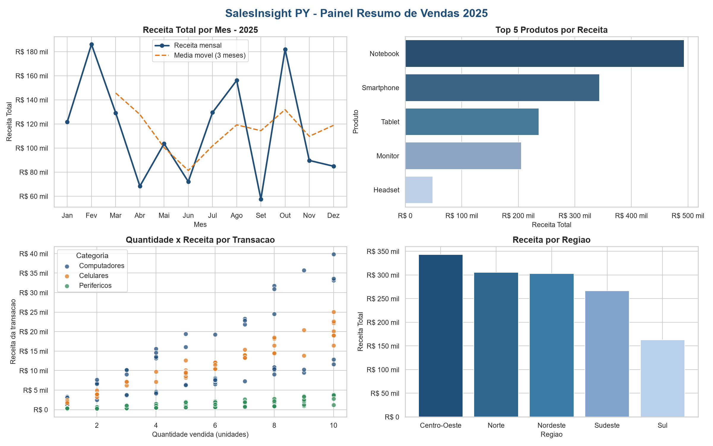

# SalesInsight PY

Análise e visualização de dados de vendas com Python.
Mini-Projeto Avaliativo · Desenvolvedor(a) em IA para Análise Preditiva · Módulo 01 · Semana 07.



## Sobre o projeto

Uma empresa de varejo precisa de um relatório analítico para a reunião trimestral da diretoria. O SalesInsight PY carrega um histórico de vendas em CSV, limpa os dados, cria colunas derivadas, calcula métricas por período, produto, categoria e região, segmenta os clientes por faixa de gasto, gera gráficos e exporta os resultados em CSV, JSON e PNG.

Todo o fluxo é um *pipeline* simples: uma sequência organizada de funções, coordenada pela classe `AnalisadorDeVendas` e executada pela função `main()`.

## O que o projeto analisa

- Receita total, quantidade e número de vendas por mês e por trimestre
- Top 5 produtos e receita por categoria
- Receita e ticket médio por região
- Segmentação de clientes em Bronze, Prata e Ouro
- Relação entre quantidade vendida e receita por transação
- Exportação de relatórios em CSV e JSON e de gráficos em PNG

## Principais resultados (dataset gerado com `seed=42`)

| Indicador | Resultado |
|---|---|
| Registros brutos / após limpeza | 200 / 194 (6 datas inválidas removidas) |
| Receita total do ano | R$ 1.380.210,31 |
| Melhor mês / pior mês | Fevereiro (R$ 186.065,22) / Setembro (R$ 57.509,42) |
| Produto líder | Notebook (R$ 493.242,63) |
| Categoria líder | Computadores |
| Região líder | Centro-Oeste (ticket médio R$ 7.297,49) |
| Clientes por segmento | 35 Ouro · 9 Prata · 5 Bronze |
| Projeção do próximo mês (média móvel de 3 meses) | R$ 118.791,34 |

**Quantidade × receita:** a receita cresce com a quantidade dentro de cada categoria, mas a inclinação muda muito: uma venda de 10 periféricos rende menos do que uma de 2 notebooks. O preço do produto pesa mais que o volume.

## Conceitos aplicados (Módulo 01, semanas 01 a 07)

| Conceito | Onde aparece no código |
|---|---|
| Variáveis, tipos (`int`, `float`, `str`, `bool`, `list`, `dict`) | Constantes de configuração, relatório de limpeza |
| Operadores aritméticos, lógicos e relacionais | `receita_total`, faixas de receita, filtros booleanos |
| `if / elif / else` | `descrever_tendencia()`, `formatar_reais()`, `main()` |
| `for` | Geração do dataset, limpeza das colunas de texto, gráfico de dispersão |
| Listas, tuplas, dicionários e estruturas compostas | Dicionário de métricas `{nome: DataFrame}`, relatório de limpeza aninhado |
| Funções com parâmetros, retorno e docstring | Todas as etapas do fluxo |
| Funções lambda (3 usos) | Segmentação de clientes, `receita_em_milhares`, `perfil_volume` |
| Função de ordem superior | `processar_coluna(df, coluna, funcao_transformacao)` |
| Módulos e importação | `pandas`, `numpy`, `json`, `os`, `random`, `datetime`, `matplotlib`, `seaborn` |
| Módulo `datetime` | Geração das datas, `pd.to_datetime`, `.dt.month`, `.dt.quarter`, `.dt.year` |
| Leitura e escrita de CSV | `pd.read_csv()`, `.to_csv()` |
| Leitura e escrita de JSON | `json.dump()` e `json.load()` para conferência |
| Pandas: filtros, `groupby`, `pivot_table` | `calcular_metricas()`, `segmentar_clientes()` |
| Transformação condicional vetorizada | `df.loc[condicao, "faixa_receita_item"] = faixa` |
| Matplotlib e Seaborn | Linha, barras, dispersão e painel 2×2 com `fig.suptitle()` |
| Customização | Título, rótulos, legenda, paleta própria, `figsize`, `tight_layout()`, `dpi=150` |
| Classe | `AnalisadorDeVendas` com `carregar`, `transformar`, `analisar`, `visualizar`, `resumo` |
| Git e GitHub | Branches `main`, `develop`, `feat/pipeline-dados`, `docs/readme` |

### Bônus implementados

- **B01** Projeção simples do próximo mês por média móvel de 3 meses (também desenhada no gráfico de linha)
- **B03** Tabela cruzada mês × categoria com `pivot_table`
- **B05** Quartis da receita por venda com `.quantile()`
- **B06** Quadro Kanban em [KANBAN.md](KANBAN.md)

## Como executar

### Google Colab (recomendado)

1. Faça upload de `salesinsight.py` (o `vendas.csv` é opcional: se não existir, o código gera).
2. Execute em uma célula: `!python salesinsight.py`
3. Os resultados aparecem na pasta `outputs/`.

### Localmente com VS Code ou terminal

1. Instale o Python 3.10 ou superior.
2. Instale as dependências:

   ```bash
   pip install pandas numpy matplotlib seaborn
   ```

3. Execute:

   ```bash
   python salesinsight.py
   ```

## Estrutura do projeto

```
salesinsight-py/
|-- salesinsight.py              # fluxo principal
|-- vendas.csv                   # dataset gerado pelo próprio código (seed=42)
|-- README.md
|-- KANBAN.md                    # organização das tarefas
|-- outputs/
    |-- metricas_por_mes.csv
    |-- segmentacao_clientes.csv
    |-- estatisticas_gerais.json
    |-- graficos/
        |-- receita_por_mes.png
        |-- top_produtos.png
        |-- quantidade_vs_receita.png
        |-- painel_resumo.png
```

## Decisões técnicas

- **Remover as datas inválidas em vez de mantê-las.** Uma venda sem data não pode entrar em nenhuma análise por mês ou trimestre, e inventar uma data distorceria a série. Como são só 6 de 200 registros (3%), removê-las tem pouco impacto no total. O relatório de limpeza mostra exatamente quantas saíram.
- **Limpeza sempre antes de tudo.** A classe só cria colunas derivadas depois de `tratar_dados()`, e os gráficos só são gerados depois das métricas. Assim nenhuma etapa trabalha com dado sujo.
- **Funções de desenho reaproveitadas.** Cada gráfico tem uma função `desenhar_*` que recebe o eixo (`ax`). A mesma função desenha a figura individual e o quadrante do painel 2×2, sem código duplicado.
- **Paleta própria.** Azul petróleo para a série principal e uma cor fixa por categoria, para que Computadores, Celulares e Periféricos tenham a mesma cor em todos os gráficos.

## O que pode melhorar

- Receber o caminho do CSV e a pasta de saída por argumentos de linha de comando.
- Criar testes automáticos para `tratar_dados()` e `segmentar_clientes()`.
- Trocar a média móvel por um modelo preditivo de verdade (Semana 13).
- Testar com um dataset real, que traga outros tipos de sujeira (nulos, espaços, duplicados).

## Ferramentas utilizadas

- Python 3.12, VS Code e Google Colab
- pandas, numpy, matplotlib, seaborn, json, datetime, os, random
- Git e GitHub

## Vídeo de demonstração

[inserir o link do Google Drive ou do YouTube aqui]
